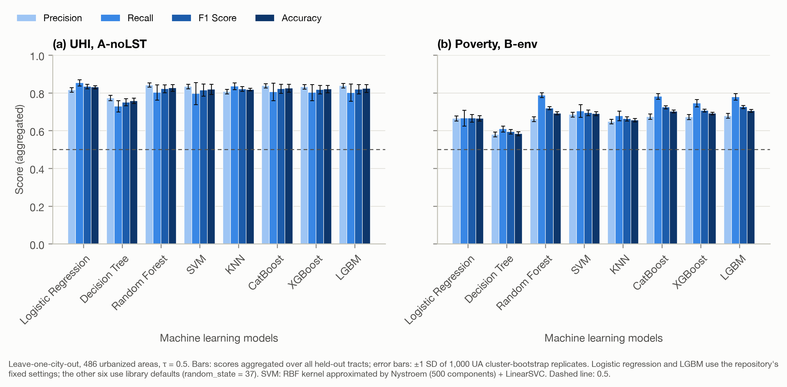

# Algorithm comparison

The algorithm comparison shows eight algorithms by precision, recall, F1 and accuracy (grouped bars, y from
0 to 1) on 54,243 tracts in 486 urbanized areas, each area held out in turn
(leave-one-city-out, 486 folds), at τ = 0.5. Panel (a) predicts High UHI from `A-noLST`
(no LST or SUHI column); panel (b) predicts High poverty from `B-env`. Each bar is the score
aggregated over all held-out tracts; its error bar is ±1 SD of 1,000 UA cluster-bootstrap
replicates (the bootstrap standard error). Table cells below are "aggregated estimate ±
bootstrap SD".

Script: [`algorithms.py`](algorithms.py). Bar values:
[`results/algorithms_bars.csv`](results/algorithms_bars.csv); ROC-AUC with 95 % UA cluster-bootstrap
intervals (1,000 replicates): [`results/algorithms_auc.csv`](results/algorithms_auc.csv).

## Results

**(a) UHI, A-noLST** — target `High_UHI`, 28 predictors; highest ROC-AUC: LGBM (0.910).

| Algorithm | Precision | Recall | F1 | Accuracy | ROC-AUC [95 % CI] |
|---|---:|---:|---:|---:|---|
| Logistic Regression | 0.816 ± 0.012 | 0.853 ± 0.016 | 0.834 ± 0.011 | 0.830 ± 0.008 | 0.899 [0.884, 0.914] |
| Decision Tree | 0.773 ± 0.014 | 0.729 ± 0.030 | 0.750 ± 0.018 | 0.757 ± 0.014 | 0.757 [0.730, 0.781] |
| Random Forest | 0.842 ± 0.011 | 0.803 ± 0.040 | 0.822 ± 0.022 | 0.826 ± 0.018 | 0.909 [0.891, 0.927] |
| SVM | 0.834 ± 0.012 | 0.797 ± 0.058 | 0.815 ± 0.032 | 0.819 ± 0.027 | 0.901 [0.861, 0.931] |
| KNN | 0.807 ± 0.012 | 0.835 ± 0.018 | 0.821 ± 0.012 | 0.818 ± 0.007 | 0.878 [0.864, 0.892] |
| CatBoost | 0.838 ± 0.011 | 0.806 ± 0.046 | 0.821 ± 0.024 | 0.825 ± 0.021 | 0.908 [0.886, 0.930] |
| XGBoost | 0.833 ± 0.012 | 0.802 ± 0.043 | 0.817 ± 0.023 | 0.820 ± 0.019 | 0.904 [0.881, 0.925] |
| LGBM | 0.839 ± 0.012 | 0.801 ± 0.046 | 0.819 ± 0.024 | 0.823 ± 0.021 | 0.910 [0.888, 0.929] |

**(b) Poverty, B-env** — target `High_Pov`, 64 predictors; highest ROC-AUC: LGBM (0.777).

| Algorithm | Precision | Recall | F1 | Accuracy | ROC-AUC [95 % CI] |
|---|---:|---:|---:|---:|---|
| Logistic Regression | 0.664 ± 0.013 | 0.667 ± 0.042 | 0.666 ± 0.021 | 0.665 ± 0.014 | 0.714 [0.670, 0.752] |
| Decision Tree | 0.580 ± 0.012 | 0.609 ± 0.016 | 0.594 ± 0.011 | 0.584 ± 0.010 | 0.584 [0.563, 0.606] |
| Random Forest | 0.661 ± 0.013 | 0.787 ± 0.013 | 0.719 ± 0.008 | 0.692 ± 0.008 | 0.763 [0.746, 0.782] |
| SVM | 0.685 ± 0.013 | 0.704 ± 0.034 | 0.694 ± 0.015 | 0.690 ± 0.011 | 0.758 [0.738, 0.781] |
| KNN | 0.649 ± 0.012 | 0.678 ± 0.025 | 0.663 ± 0.011 | 0.655 ± 0.009 | 0.700 [0.679, 0.722] |
| CatBoost | 0.674 ± 0.014 | 0.781 ± 0.016 | 0.724 ± 0.008 | 0.702 ± 0.008 | 0.773 [0.754, 0.792] |
| XGBoost | 0.672 ± 0.013 | 0.746 ± 0.019 | 0.707 ± 0.007 | 0.691 ± 0.007 | 0.756 [0.740, 0.775] |
| LGBM | 0.679 ± 0.013 | 0.779 ± 0.017 | 0.725 ± 0.009 | 0.705 ± 0.008 | 0.777 [0.758, 0.796] |

## Settings

- **Logistic regression and LGBM** are the repository's own runs, read from the cached
  out-of-fold engine (`validation.oof`) with the fixed settings (logistic C = 1,
  max_iter = 5000; LightGBM 400 trees, learning rate 0.05, 31 leaves), not library defaults.
  Their values match section 4.4's
  [`metric_panel.csv`](../4_Model_Specifications/4.4_Metric_Panel_with_Uncertainty/results/metric_panel.csv)
  exactly (largest absolute difference over 20 estimates and CI bounds:
  0.0e+00; [`results/algorithms_repo_check.csv`](results/algorithms_repo_check.csv)).
- **Decision tree, random forest, SVM, KNN, CatBoost, XGBoost** use library defaults with
  `random_state = 37`, single-threaded, nothing tuned. Each fold refits the whole pipeline:
  median imputation, and for KNN and SVM `log1p` on `Area`, `Total_Count` and `Urban_Count`
  followed by standardisation.
- **SVM** is an approximation: an exact RBF SVM refitted 486 times on ~54,000 rows is
  impractical, so the RBF kernel is approximated by `Nystroem(n_components=500)` followed by
  `LinearSVC`. Its class is decision function ≥ 0 and its ROC-AUC is computed from the
  uncalibrated decision function.
- Bars are aggregated (pooled) over all out-of-fold predictions, not averaged over cities.
  Error bars are ±1 SD of the same 1,000 UA cluster-bootstrap replicates that give the
  ROC-AUC intervals. Out-of-fold predictions of the six other models are cached under
  `data/interim/figures/algorithms/`.
